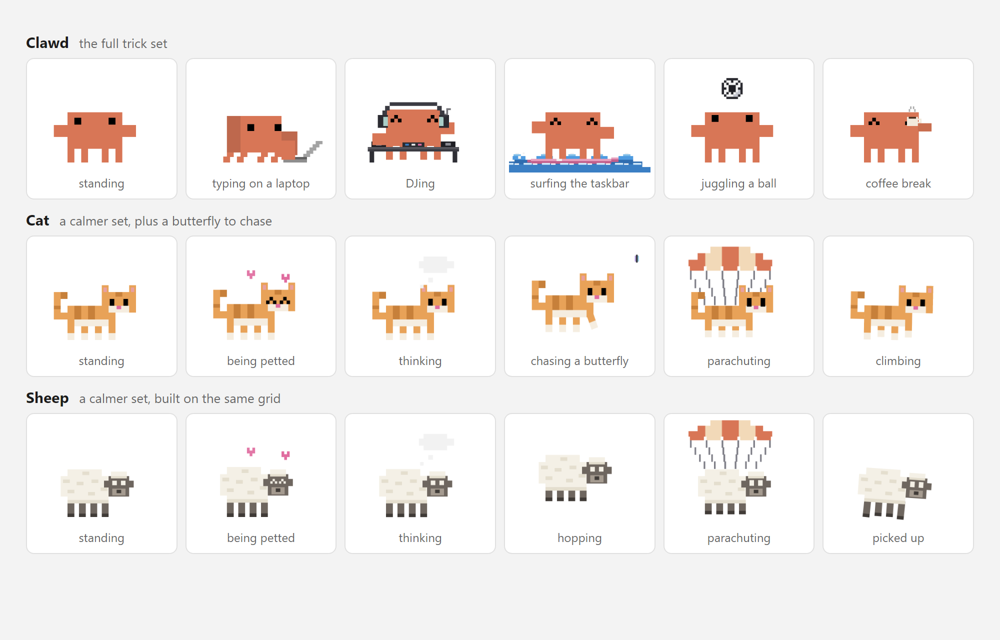
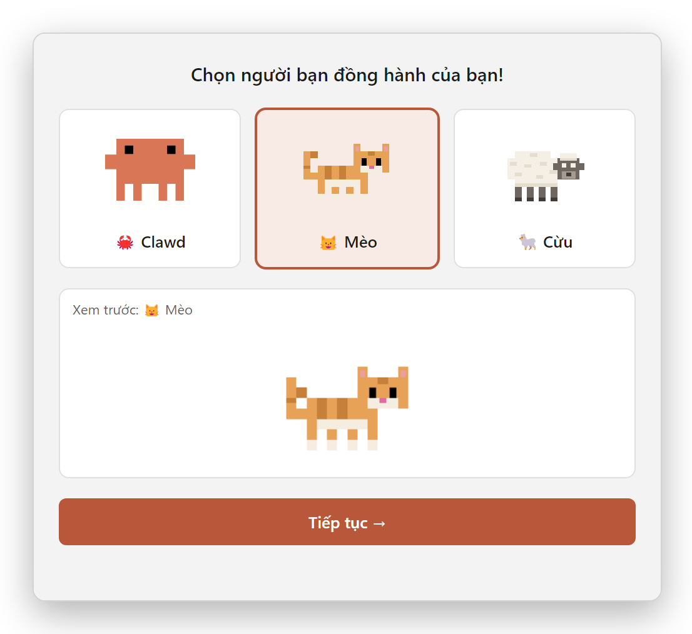
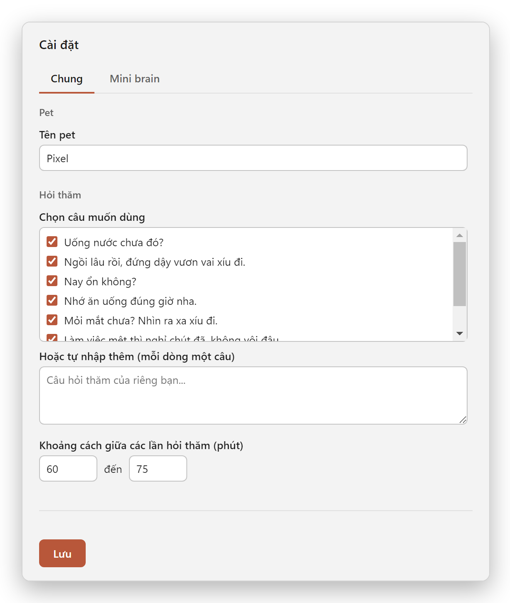
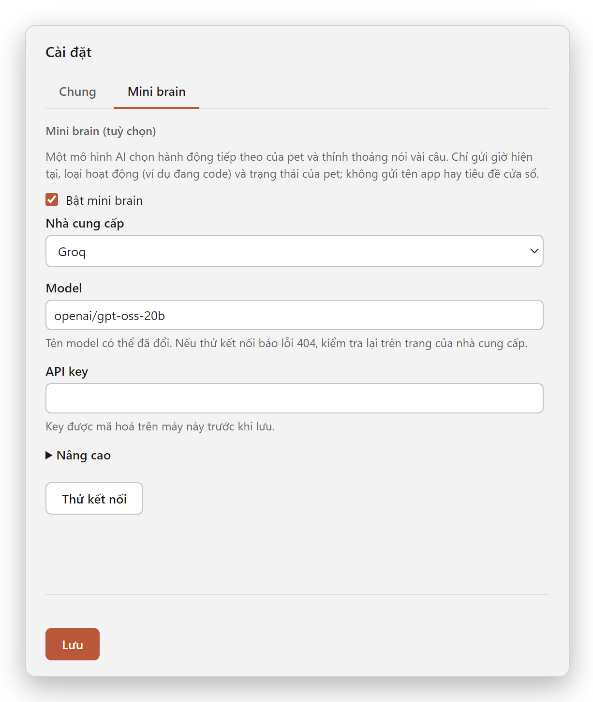
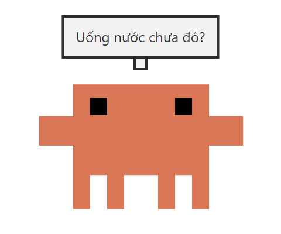

  

  # Pixel Pet

  A pixel-art desktop pet for Windows. Pick Clawd, a cat or a sheep; it wanders
  along your taskbar, reacts to you, does tricks, checks in on you now and then,
  and can even use an LLM as a tiny brain.

  
  
  
  
  
  

   

  <picture>
    <source media="(prefers-color-scheme: dark)" srcset="docs/images/showcase-dark.png">
    
  </picture>

 

On first launch it asks which companion you want, then walks along the taskbar
on its own and every so often breaks into a trick. Pick it up and drop it and it
free-falls, sometimes with a parachute. It is a transparent, always-on-top,
click-through window, so it never blocks what is underneath it.

## Download

Grab **`pixel-pet.exe`** from the [latest release](https://github.com/jin3107/pixel-pet/releases/latest)
and run it. The installer is not code-signed, so Windows SmartScreen may warn
you the first time ("More info", then "Run anyway"). The installed app starts
with Windows; untick **Chạy cùng Windows** in the tray menu if you do not want that.

> The interface text (tray menu, settings, the default check-in messages) is
> currently in Vietnamese.

## The pets

| | Tricks |
| --- | --- |
| **Clawd** (the crab) | `code` (sits down to type on a laptop), `music` (DJs with headphones), `soccer` (juggles a ball), `surf` (rides a board along the taskbar), `coffee`, `jump`, `climb`, `think` |
| **Cat** | `jump`, `climb`, `think`, and `butterfly` (crouches, tracks a butterfly, pounces) |
| **Sheep** | `jump`, `climb`, `think` |

All three are built the same way: hand-placed pixel rectangles on one grid (no
images), so they blink, walk, dangle when picked up, get happy `^ ^` eyes when
petted, `X` eyes when dropped, and open a parachute.

Things you can do with the mouse:

- **Hover its head** to pet it (hearts).
- **Click and hold** to pick it up, drop it anywhere and watch it fall.
- It **sidesteps your pointer** when you come close, and **walks over to your
  cursor** if the mouse has been still for a while.

## Screenshots

### Choose your pet (with a live preview)

  <picture>
    <source media="(prefers-color-scheme: dark)" srcset="docs/images/picker-dark.png">
    
  </picture>

Open it any time from the tray menu (**Đổi pet...**). Selecting a card shows the
real sprite animating before you switch.

### Settings

  <picture>
    <source media="(prefers-color-scheme: dark)" srcset="docs/images/settings-general-dark.png">
    
  </picture>
  <picture>
    <source media="(prefers-color-scheme: dark)" srcset="docs/images/settings-brain-dark.png">
    
  </picture>

### Check-ins

  

About once an hour it pauses and shows a short check-in (drink water, stretch,
rest your eyes...). The bubble is its own overlay window, not an OS
notification, so it appears even if system notifications are off. You choose
which messages are used, add your own, and set the interval in **Settings**.
(If you turn on app awareness, below, it speaks at moments that fit what you are
doing instead of on this timer.)

## Optional features

Both are **off by default**. Switch them on from the tray menu; Mini brain is
also configured in **Settings**.

### Notice what I am doing

With **Pet quan sát app đang dùng** on, the pet reads the foreground window's
process name and title every 30 seconds, using a one-shot PowerShell call. From
that it works out a category (coding, chat, browsing, video, docs, game, ...),
which it uses to:

- mirror you: Clawd types on its laptop while you code and DJs while you listen
  to music;
- speak up at sensible moments instead of on a blind timer: when you come back
  after a break, when you have been focused or scrolling for a long time, or
  late at night. It stays quiet during games, video, music and fullscreen apps,
  and never talks more than once every 25 minutes.

What it keeps: a short timeline of app and category kept **in memory only**
(nothing is written to disk, a restart starts fresh). Banking sites, password
managers and private/incognito windows are reported as "private" with the title
dropped. It never takes screenshots.

### Mini brain

With **Mini brain** on, an LLM picks the pet's next action and occasionally says
a short line. It works with any OpenAI-compatible endpoint: Groq, Google Gemini,
xAI, a local Ollama server (no key needed), or your own.

- **Safe by construction:** the model can only choose among the actions that
  pet actually has, and the normal behavior keeps running while it thinks. If it
  is slow, offline, out of credit or answers badly, the pet simply carries on as
  usual and retries later.
- **What is sent:** the hour, the activity category (for example "coding"), the
  pet's name, model and current action, and its last few choices. Never window
  titles or app names.
- **Your key:** pasted in Settings, it is encrypted with the OS (Electron
  `safeStorage`) before it is saved and never shown again. The environment
  variables `BRAIN_API_KEY` or `XAI_API_KEY` take precedence if set.
- **Cost:** at most one short request every 30 seconds while it is on (it only
  asks when the pet is ready for its next action). Free tiers exist at some
  providers and change often, so check theirs.

## Privacy

Pixel Pet makes no network requests of its own unless you turn on **Mini brain**,
and then only to the endpoint you chose. There is no telemetry. Settings live in
`%APPDATA%\pixel-pet\pet-config.json`.

## Requirements

- Windows

## Contributing

Want to run it from source, build the installer or add a trick? See
[CONTRIBUTING.md](CONTRIBUTING.md). To report a security problem, see
[SECURITY.md](SECURITY.md).

## Credits and disclaimer

Clawd is inspired by the pixel mascot of Claude. Pixel Pet is an independent fan
project and is not affiliated with or endorsed by Anthropic.

## License

MIT, see [LICENSE](LICENSE).
